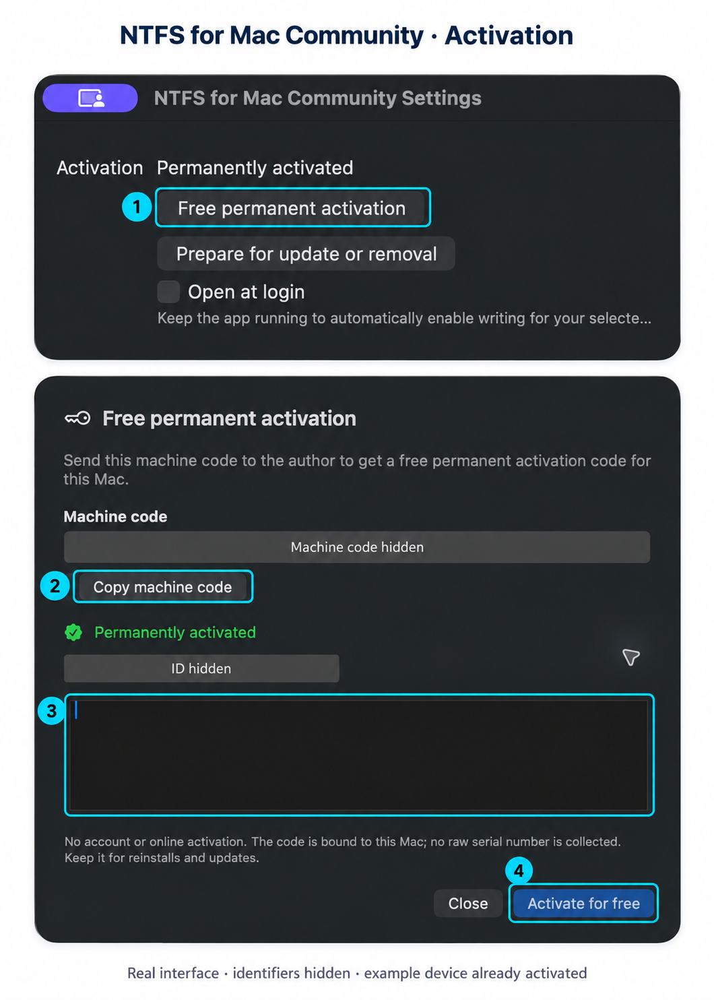

# 免费激活图文教程

适用于 **NTFS for Mac Community 0.3.0**。首次使用按「安装与系统授权 → 获取绑定码 → 激活 → 自动自检 → 测试盘写入」完成。

[下载最新版](https://github.com/ebrx/ntfs-for-mac-releases/releases/latest) · [先看安装顺序](INSTALLATION.md) · [English guide](ACTIVATION-GUIDE.en.md)

## 界面位置一览

*上图根据 0.3.0 实机英文界面截图脱敏、标注制作。本机机器码和授权编号已隐藏。截图设备已激活，因此显示绿色状态；新用户激活前不会显示「已永久激活」。界面语言不同，位置与功能相同。不要复制图片里的占位文字。*

| 图中编号 | 英文按钮/位置 | 中文对应 | 操作 |
| --- | --- | --- | --- |
| ① | Free permanent activation | 免费永久授权 | 打开授权面板 |
| ② | Copy machine code | 复制机器码 | 复制这台 Mac 的机器码，私信作者 |
| ③ | Activation code 输入框 | 授权码输入框 | 粘贴作者回复的完整激活码 |
| ④ | Activate for free | 免费激活 | 确认激活，随后等待自动自检 |

## 1. 打开免费永久授权

从「应用程序」打开 **NTFS for Mac Community**。在应用处于前台时按 **⌘,** 打开设置，点击图中 **①「免费永久授权」**。也可从菜单栏中的应用菜单进入「设置」。

先按[安装指南](INSTALLATION.md)安装最新版，并分别允许两个 macFUSE 文件系统扩展、社区版后台服务和完全磁盘访问。激活码不会代替这些系统授权。

## 2. 复制机器码并私信领码

点击图中 **②「复制机器码」**。机器码以 **`NTFSM-`** 开头，代表这台 Mac；不是原始 Mac 序列号。

打开 [B站实机演示视频](https://www.bilibili.com/video/BV1Lmp36JEz7/)，点击作者 **「码上实现」** 头像进入主页，通过 **B站私信**发送：

> 你好，我想体验 NTFS for Mac Community 0.3.0。
> 机器码：[粘贴应用复制的完整机器码]
> 芯片：[例如 M3；不确定可截图「关于本机」并隐藏个人信息]
> macOS：[版本和构建号]
> 如遇问题，我会反馈操作步骤和完整错误。

**必须提供机器码和应用版本**；建议附芯片型号、macOS 版本与构建号，方便核对兼容情况。无需 Apple ID、原始 Mac 序列号、密码、付款或硬盘内的文件。不要把机器码或激活码贴在公开评论区或 Issues。

## 3. 粘贴作者回复的激活码

作者会私信回复以 **`NTFSM2.`** 开头的绑定激活码。回到刚才的授权面板，在图中 **③输入框**粘贴**完整激活码**。

| 内容 | 从哪里来 | 用在哪里 |
| --- | --- | --- |
| `NTFSM-…` 机器码 | 应用「复制机器码」 | 私信发给作者申请激活码 |
| `NTFSM2.…` 激活码 | 作者私信回复 | 粘贴到授权码输入框 |

**不要把机器码当作激活码粘贴。** 不添加说明文字、引号或省略号；复制完整内容。输入框为空时，激活按钮置灰属于正常情况。示例前缀不能用来激活。

## 4. 点击免费激活并确认状态

点击图中 **④「免费激活」**。成功后可再次打开「设置」核对 **「已永久激活」**；英文为 **Permanently activated**。设置里的授权状态和面板中的绿色标志都可用于确认。

激活免费、永久、离线验证，无需在线账号。同一 Mac 常规重装和更新可沿用绑定码；换机或主板身份变化需免费重新签发。旧版 NTFSM1 通用码不能用于 0.3.0，请免费换领。

## 5. 等待自动自检，再使用测试盘

回到主窗口，等待应用自动完成可丢弃 NTFS 镜像自检。通过前实盘写入保持关闭；成功后顶部自检提示会收起。出现错误时查看详情、记录完整错误并联系作者，不反复强制退出或拔盘。

通过后，先连接**无重要数据的测试盘**，核对盘名和容量，点击「开启写入」，等待显示可读写，再点「在 Finder 中打开」。新建独立测试目录，放入一个测试文件，用 **⌘C / ⌘V** 验证复制；结束时正常弹出。不要用重要数据盘作为第一次测试对象。

系统、应用、后台服务或依赖更新后会重新自检。准入范围为 Apple Silicon / macOS 26.4–27.x；不代表所有设备和系统都已实测，详见[实际测试范围](TESTED.md)。

## 常见问题

| 情况 | 处理方式 |
| --- | --- |
| 找不到授权入口 | 确认打开的是 **Community**；按 ⌘, →「免费永久授权」，不是「准备更新或卸载」 |
| 激活码无效或属于另一台 Mac | 核对完整复制；确认机器码与领码时一致，私信作者核对。不要公开激活码 |
| 我有旧版通用码 | 提供当前机器码，免费换领 NTFSM2 绑定码 |
| 显示已激活，但仍只读 | 核对两个扩展、后台服务、完全磁盘访问及当前自检状态；激活不会跳过脏卷/休眠检查 |
| 显示 TUXERA_NTFS | 该卷由其他驱动挂载，其读写不能作为本软件的验证结果 |
| 换了另一块移动硬盘 | 激活绑定 Mac，不绑定某块硬盘；新磁盘的自动写入选择需单独设置 |

领码是为了控制早期使用范围，并建立问题反馈联系；没有收费或其他目的。遇到问题请提供应用版本、芯片、系统版本/构建号、操作步骤和完整错误，隐藏个人信息，不发送私人文件或密码。

[领码与反馈详情](ACTIVATION.md) · [安装指南](INSTALLATION.md) · [常见问题](FAQ.md) · [下载最新版](https://github.com/ebrx/ntfs-for-mac-releases/releases/latest)
