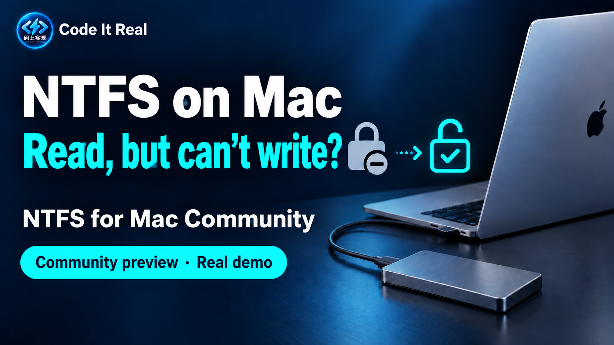
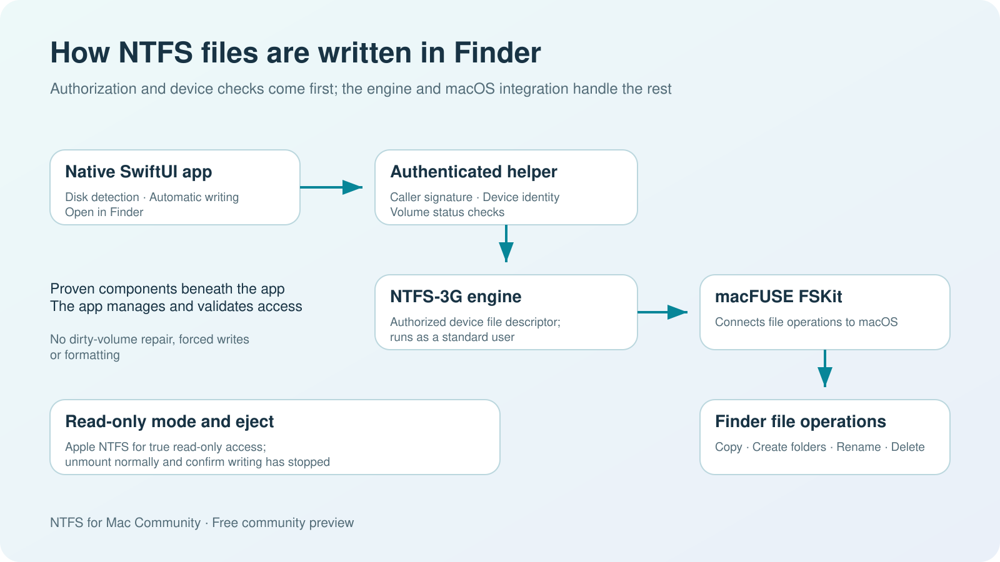
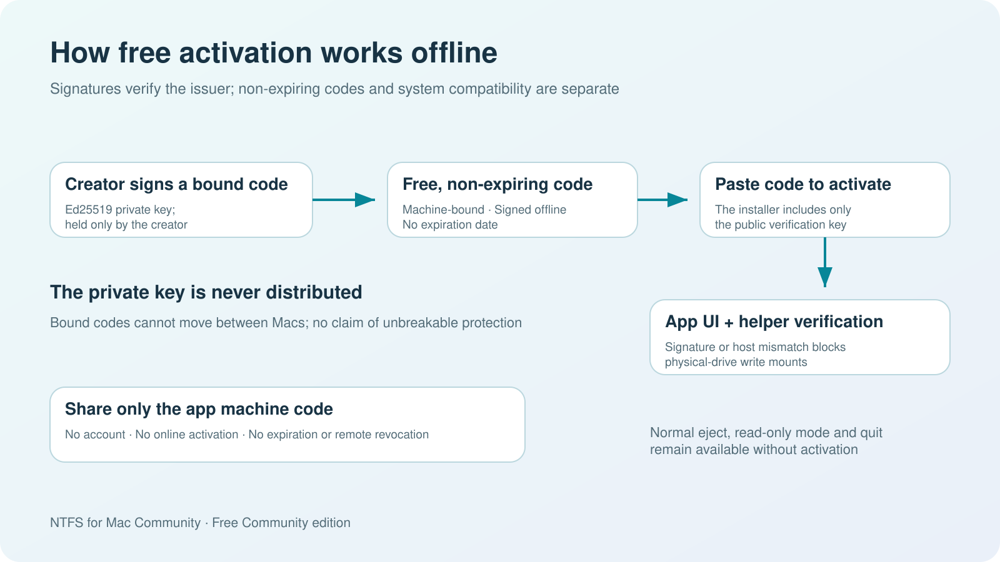

# NTFS for Mac Community

[简体中文](README.md) | **English**

A free NTFS write utility for Mac, with a native SwiftUI interface in Chinese and English. No subscription, ads, or online activation.

## Download the stable release

[**Download the latest release (GitHub Releases)**](https://github.com/ebrx/ntfs-for-mac-releases/releases/latest)

| Item | Details |
| --- | --- |
| Current version | **0.3.0** |
| Installer | [NTFS-for-Mac-Community-0.3.0-All-in-One-arm64.pkg](https://github.com/ebrx/ntfs-for-mac-releases/releases/download/v0.3.0/NTFS-for-Mac-Community-0.3.0-All-in-One-arm64.pkg) |
| Eligibility | Apple Silicon, macOS 26.4–27.x; per-Mac self-test required |
| Included | App, NTFS-3G and official macFUSE 5.4.0 |
| Integrity | [SHA256SUMS](https://github.com/ebrx/ntfs-for-mac-releases/releases/download/v0.3.0/SHA256SUMS) |
| Activation | Free, perpetual, offline and machine-bound; [request a code](ACTIVATION.en.md) |

**Install only the All-in-One `.pkg` above.** `Source code` archives contain this public documentation repository; `third-party-source` contains dependency sources. Neither is an installer.

[Illustrated activation](ACTIVATION-GUIDE.en.md) · [Installation](INSTALLATION.en.md) · [Activation](ACTIVATION.en.md) · [Tested scope](TESTED.en.md) · [FAQ](FAQ.en.md) · [Archived versions](ARCHIVE.md)

## Video demo and contact

**Watch the hands-on demo: [YouTube (English)](https://youtu.be/IVS50FnyGXk) · [Bilibili (Chinese)](https://www.bilibili.com/video/BV1Lmp36JEz7/)** · Creator: **Code It Real / 码上实现**

The video shows the app switching an NTFS drive from read-only to writable, then copying a test file, creating a folder, and renaming it. It uses the community preview available when it was recorded. For current downloads, supported configurations, and setup steps, follow this repository's documentation.

- **Free activation codes and contact:** Open the video, click the creator's avatar, and send **码上实现** a private message on Bilibili. Say that you would like to try NTFS for Mac Community. See the activation section below for details.
- **Bug reports:** Use Bilibili private messages or [GitHub Issues](https://github.com/ebrx/ntfs-for-mac-releases/issues). Include your chip, macOS version and build number, app version, and error text.
- **Software requests:** Leave a comment on the [YouTube demo](https://youtu.be/IVS50FnyGXk) or the Bilibili video describing the tool you want, the problem it should solve, and your use case. These requests help guide future tools.

**Code It Real — your wishlist for free software. You ask, I build.**

## Start here

**0.3.0: Apple Silicon (including M5), macOS 26.4–27.x, macFUSE 5.4.0.** Installation uses a version range rather than an exact OS build whitelist. Activation and automatic disposable-image self-test must pass on this Mac before physical writing. OS, app, helper or dependency updates trigger a fresh test. Eligibility is not a claim that every chip, OS and device has been tested.

1. Open the [latest stable release](https://github.com/ebrx/ntfs-for-mac-releases/releases/latest), download the All-in-One PKG listed above and double-click it. Matching macFUSE is retained.
2. Follow the [English installation guide](INSTALLATION.en.md) to allow the installer/app, enable both macFUSE file-system extensions, approve the community background service, and grant Full Disk Access. After granting permissions, quit the app normally and reopen it.
3. Copy the machine code from Free Activation and send it to the creator. Paste the matching code, wait for automatic self-test to pass, and start with an expendable disk before writing in Finder.

The all-in-one package installs the components, but you must still approve each required system setting. If the extension list does not show both macFUSE entries, follow the installation guide to register them for the current user with the official tool. If prompted to shut down and open Startup Security Utility, cancel and use the file-system extension settings instead. If the app mentions removable volumes but System Settings shows Full Disk Access, check that permission and quit/reopen the app normally.

**After initial setup and enabling automatic writing for a drive, reconnecting it while the app is running triggers a check and mount automatically.** Configure new drives separately. You can also enable “Open Finder after automatically enabling writing.” For devices without a volume UUID, the app remembers your choice using a verified NTFS serial number and capacity; changes to the drive letter, name, or interface do not change that identity. If it cannot read a valid persistent identity, writing must be enabled manually. Eject normally before disconnecting. The package combines installation into one entry point; first-time macOS security and permission approvals still require your action.

[English installation guide](INSTALLATION.en.md) · [English FAQ](FAQ.en.md) · [中文安装步骤](INSTALLATION.md) · [PKG checksum](https://github.com/ebrx/ntfs-for-mac-releases/releases/download/v0.3.0/SHA256SUMS) · [Current package version](https://github.com/ebrx/ntfs-for-mac-releases/blob/main/downloads/latest.json)

Use **GitHub Releases** for the current version, installer filename and SHA-256. Old application installers have been withdrawn; changelogs and corresponding third-party sources remain [archived](ARCHIVE.md).

The release page's `Source code` downloads contain this public repository's documentation; `third-party-source` contains dependency source code. **For installation, choose the All-in-One PKG linked above.**

**0.3.0 copy fix:** Fixes Finder duplicates appearing and then disappearing for files with empty FinderInfo metadata. The installed build passed all twelve image checks and the real-drive Finder regression; the duplicate persisted and original content was unchanged. See the [validation record](validation/0.3.0.json).

**Automatic writing and Finder:** Version 0.2.5 adds a per-drive automatic Finder option and remembers automatic writing choices for NTFS USB drives without a UUID. It includes the button compatibility fix from 0.2.4. Devices are checked against the current connection identity and NTFS boot-sector serial number. Dirty and hibernated volumes are still rejected. 0.3.0 requires a new, free machine-bound NTFSM2 code; legacy NTFSM1 codes remain for old versions. If updating an older community version, first choose “Prepare for update or uninstall” in Settings, quit normally, and then install the new version.

**Recovering a failed installation:** Version 0.2.3 fixes the update-preparation flow when drivers are missing and retains checks/repairs for first-time installation and missing services. If an older installation is stuck with “NTFS dependencies are unavailable or their signature is invalid,” follow the [recovery instructions in the FAQ](FAQ.en.md) to reinstall the official dependencies before preparing the update. Downloading only the main app cannot repair an older service that is still running.

## Free activation codes

The app is in early testing and may still have stability or compatibility issues. Free activation codes help keep the initial testing group manageable. Requesting one by private message also gives you a way to reach the creator, report problems, and get updates. The codes are free, have no expiration, and are verified offline.

NTFSM2 codes in 0.3.0 are bound to the application machine code, not an Apple ID or account. It is a domain-separated hash of the hardware UUID, not the raw Mac serial number. Nothing is automatically uploaded: users copy it to the author for signing. Both GUI and root helper derive their own host identity and verify the signature and match. Same-Mac ordinary reinstalls and updates retain the code; another Mac or major hardware identity changes require free reissue. There is no remote revocation and no claim of unbreakable DRM. Permanent licensing does not promise support for all future systems.

## Current validation scope

Update on **2026-10-28**: the author confirmed successful operation after upgrading the local Mac to **macOS 27.2 (26B123)**. The installed app is still **0.3.0 (build 10)** and its executable matches the published build. This is post-upgrade user feedback; a twelve-check self-test export and itemized physical-disk test report have not been collected for this OS. It does not validate every macOS 27 build, chip or device.

[27.2 feedback record](validation/2026-10-28-macos27.2-feedback.json).

The installed 0.3.0 build passed local 26.6.2 (25G83) installation, all twelve image checks and the additional real Drive same-directory Finder copy. The duplicate persisted, hashes matched and the user separately confirmed success. See [tested scope](TESTED.en.md) for actual results and remaining limits.

See the [0.3.0 installation and complete image-chain evidence](validation/0.3.0.json). Post-upgrade successful operation has been reported on macOS 27.2; independent full-chain evidence for that OS is still pending. A TUXERA_NTFS mount belongs to another driver and cannot validate this software. Both macFUSE extensions need separate approval.

The validated environment is Apple Silicon, macOS 26.6.2 / 25G83, and macFUSE 5.4.0. Tests passed for reading/writing a locally created NTFS image, recovery after restarting the helper service, true read-only mode, normal ejection, and activation checks. The all-in-one package's app bytes, signature, and original macFUSE components were checked for consistency. Local installer options were confirmed to skip the same installed macFUSE version.

**On October 10, 2026, the user confirmed successful installation on two Apple Silicon Macs, including an M3 Mac. Both were checked to run macOS 26.6.2 (25G83). The M3 Mac completed configuration and NTFS image read/write checks, and the user confirmed successful writing to a real drive.** Setup required manually registering the extensions and separately granting Full Disk Access. An 8 GB MBR USB drive without a UUID passed tests for Chinese directory names, renaming, Finder copying, SHA-256 readback after switching between read/write modes, refusal to write in true read-only mode, and normal ejection. Version 0.2.5 also passed automatic writing and automatic Finder opening after reconnecting a device without a UUID. The test directory was moved back to the Mac.

Independent extension registration on a clean Mac using only the all-in-one installer, every device/system combination, and complete metadata compatibility have not yet been validated. 0.3.0 permits self-test within macOS 26.4–27.x; the actual OS build and complete code/dependency fingerprint still invalidate root-owned receipts on changes. Historical evidence is never relabeled as a new OS pass. Intel, macOS 28 or later, and mismatched dependencies remain unsupported.

The app is not notarized and does not have a Developer ID distribution signature. The outer PKG is unsigned; the app uses a free Apple Development certificate. macOS may block it on first launch; follow the [installation guide](INSTALLATION.en.md). Keep system protections enabled. This version does not require disabling SIP or lowering startup security.

## How it works

The main app handles disk detection, mount management, automatic writing, and Finder access. NTFS-3G connects through macFUSE's FSKit backend. An authenticated helper verifies the caller, disk identity, engine, and permissions. The write engine runs as a normal user. Read-only mode uses Apple's NTFS implementation. Quitting or ejecting waits for writing to stop cleanly. Dirty and hibernated volumes are rejected. The app does not format, repair, force-write, or unlock BitLocker volumes.

The creator signs activation codes locally. The app stores only the public key. There is no online verification or cloud switch.

## Feedback and source code

Include your macOS version and build number, chip, app version, and error text in reports. Do not send passwords, activation codes, or private files from your drive. Download the latest installer using the GitHub / Gitee direct links above. Release notes and third-party source remain in this repository's Releases; you can also message the creator for information.

The main project's source remains private. This public repository contains installers, documentation, architecture diagrams, and required corresponding third-party source materials. See [THIRD-PARTY.md](THIRD-PARTY.md) and [FREEWARE-LICENSE.txt](FREEWARE-LICENSE.txt) for components and licenses.
