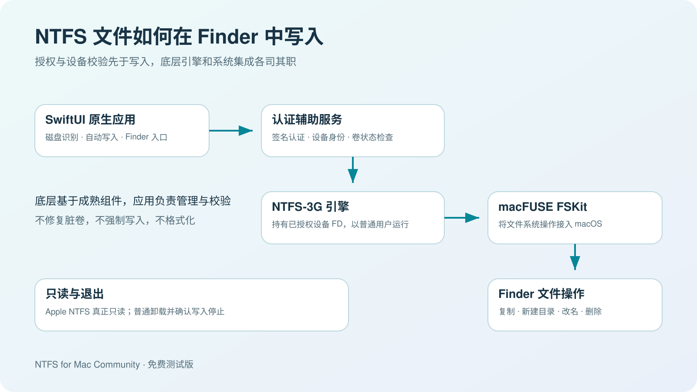
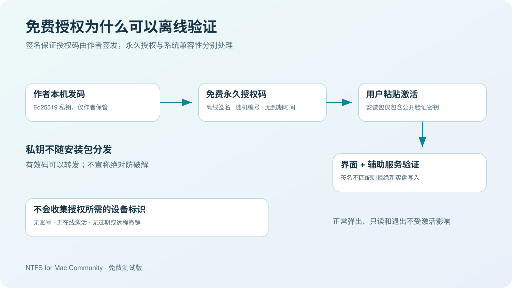

# NTFS for Mac Community

免费的 Mac NTFS 写入工具。SwiftUI 原生界面，中英双语，无订阅、广告或在线激活。

## 从这里开始

**先确认系统：当前预览版仅支持 Apple Silicon（M 系列芯片）+ macOS 26.6.2（25G83）。** 左上角苹果菜单 → 关于本机，点击系统版本查看构建号。不符合这个范围，请等待适配版本。

1. [下载合并安装包（PKG）](https://github.com/ebrx/ntfs-for-mac-releases/releases/download/v0.2.2-preview.1/NTFS-for-Mac-Community-0.2.2-All-in-One-arm64.pkg)，双击安装。包含主应用、NTFS-3G 引擎和 macFUSE 5.4.0，**不用再单独下载驱动**；已有同版本 macFUSE 会跳过重装。
2. 按 [详细安装步骤](INSTALLATION.md) 完成系统安全确认、两个 macFUSE 文件系统扩展开关和社区版后台服务批准。
3. 私信作者免费领码，在应用中激活；选中自己的 NTFS 硬盘，开启写入，再从 Finder 操作文件。

首次设置提示区可直接打开「隐私与安全性」和扩展设置；被系统阻止而无法运行的安装包仍需先手动放行。

**首次设置完成、为该磁盘选择自动写入后，应用运行期间再次插入会自动检查并挂载。** 新磁盘需单独选择；拔线前正常弹出。安装合并为一个入口，macOS 的首次安全与权限确认仍需本人操作。

[详细安装顺序](INSTALLATION.md) · [常见问题](FAQ.md) · [English installation](INSTALLATION.en.md) · [全部下载与校验值](https://github.com/ebrx/ntfs-for-mac-releases/releases/tag/v0.2.2-preview.1)

下载区的 `Source code` 是本公开仓库的说明材料；`third-party-source` 是依赖源码。**安装只选上面的 All-in-One PKG**。

## 免费激活码说明

软件目前处于早期测试阶段，仍可能存在不稳定或兼容性问题。免费激活码仅用于尽量控制初期试用范围，避免问题影响过多用户；通过私信领取，也让你在遇到问题时知道如何联系作者、反馈情况和获取更新。没有其他目的。激活码免费领取、永久有效、离线验证。

不绑定 Apple ID、账号或设备；代码可以转发，不是强防复制 DRM。原本机版无需激活。授权码无有效期，但系统更新可能需要新的兼容版本，也不承诺无限期维护。

## 当前验证范围

当前环境：Apple Silicon、macOS 26.6.2 / 25G83、macFUSE 5.4.0。社区版自建 NTFS 镜像读写、辅助服务重启恢复、真正只读、正常弹出和授权门槛已通过。合并安装包的应用字节、签名及原版 macFUSE 组件一致性已检查；本机安装选项确认会跳过同版本 macFUSE。

**尚未完成其他用户的新机器安装、社区版真实物理磁盘及界面粘贴激活的完整验收。** 当前为小范围预览版，其他 OS build、Intel 或依赖版本不符合验证范围时拒绝启用写入。

未公证、无 Developer ID 发行签名，外层 PKG 未签名；应用使用免费 Apple Development 证书。首次可能被 macOS 拦截，按 [安装说明](INSTALLATION.md) 处理。请保留系统保护；本版不需要关闭 SIP 或降低启动安全级别。

## 实现机制

主应用负责识别磁盘、挂载管理、自动写入和 Finder 入口。NTFS-3G 通过 macFUSE 的 FSKit 后端接入 macOS；认证辅助服务核对调用者、磁盘身份、引擎和权限，写入引擎以普通用户身份工作。只读使用 Apple NTFS；退出和弹出等待写入正常停止。脏卷或休眠卷拒绝写入，不提供格式化、修复、强制写入或 BitLocker 解锁。

作者在本机签发授权码，应用内只存公钥；没有联网验证或云端开关。

## 反馈与源码

反馈请提供 macOS 版本和构建号、芯片、应用版本及错误文字。不要发送密码、授权码或磁盘私人文件。更新放在本仓库 Releases，也可私信作者获取信息。

主项目源码保留在私有仓库。本公开仓库用于安装包、说明、机制图及必要的第三方对应源码材料。组件与许可证见 [THIRD-PARTY.md](THIRD-PARTY.md) 和 [FREEWARE-LICENSE.txt](FREEWARE-LICENSE.txt)。
